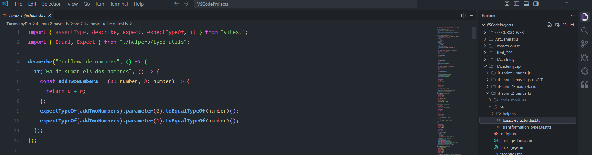
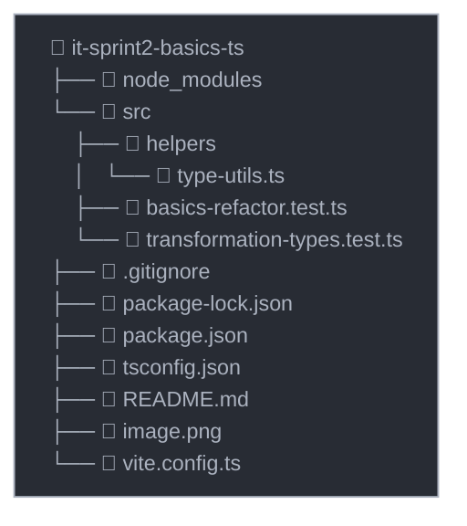

# Funcionalidades de TypeScript

---

## Descripción

Este proyecto consta de ejercicios prácticos para aprender los conceptos básicos de TypeScript y los tipos de transformación. Los ejercicios están organizados en dos ficheros de test principales.

---

## Vista previa



---

## Estructura del proyecto



---

## Tecnologías usadas

- **Node.js** (Entorno de ejecución)
- **TypeScript** (Lenguaje con tipado estático)
- **Vitest** (Entorno de pruebas)
- **Husky** (Automatización con Git Hooks)
- **npm / pnpm** (Gestores de paquetes)

---

## Instalación y ejecución

Sigue estos pasos ordenados para configurar tu entorno, instalar todas las dependencias necesarias y ejecutar el proyecto localmente:

### 0. Preparar el entorno (Requisitos)

Asegúrate de tener instalados los siguientes programas globales:

- Un navegador web moderno (Chrome, Firefox, Edge, Safari)
- Un editor de código (recomendado: **VS Code**)
- **Git**: Requerido para clonar y gestionar el repositorio.
  - _Windows/Mac:_ Descarga el instalador oficial desde [git-scm.com](https://git-scm.com).
  - _Linux (Ubuntu/Debian):_ Instálalo desde la terminal ejecutando `sudo apt install git`.
  - _Puedes verificar tu instalación ejecutando `git --version` en la terminal._

### 1. Instalar Node.js

Este proyecto requiere una versión LTS activa de Node.js (**v20.x o superior**). Elige uno de los siguientes métodos para instalarlo:

- **Opción A (Recomendada - Instalador Oficial):** Descarga e instala la versión LTS correspondiente a tu sistema operativo desde la [web oficial de Node.js](https://nodejs.org).
- **Opción B (Para desarrolladores - Usando NVM):** Si usas el gestor de versiones Node Version Manager, ejecuta los siguientes comandos en tu terminal:

```bash
nvm install 20
nvm use 20
```

- **Opción C:** Si utilizas _pnpm_:

```bash
pnpm env use --global lts
```

_Puedes verificar que se ha instalado correctamente abriendo una nueva terminal y ejecutando `node -v` o `node --version`._

### 2. Instalar el gestor de paquetes pnpm (Opcional)

El proyecto incluye `package-lock.json` para trabajar directamente con **npm** (incluido con Node.js). Si prefieres utilizar **pnpm** de forma global en tu máquina, instálalo ejecutando:

- **Opción A:** mediante _npm_

```bash
npm install -g pnpm
```

- **Opción B:** mediante comando _curl_

```bash
curl -fsSL https://get.pnpm.io/install.sh | sh -
```

### 3. Clonar el repositorio

```bash
git clone https://github.com/IT-Academy-BCN/it-sprint2-basics-ts
cd it-sprint2-basics-ts
```

### 4. Desvincular el repositorio original

Ejecuta este comando para eliminar el enlace remoto inicial:

```bash
git remote rm origin
```

### 5. Vincular el proyecto a tu propia cuenta de GitHub

Sustituye `<URL-de-tu-repositorio>` por la URL de tu repositorio personal de GitHub:

```bash
git remote add origin <URL-de-tu-repositorio>
```

### 6. Instalar las dependencias

Instala los paquetes necesarios utilizando el gestor que prefieras:

_Si usas npm (recomendado por el lockfile del proyecto):_

```bash
npm install
```

_Si usas pnpm:_

```bash
pnpm install
```

### 7. Ejecutar las pruebas (Tests)

#### Git Hooks con Husky

El proyecto utiliza **Husky** para automatizar la validación del código antes de hacer los commits. Esto garantizará que solamente se pueda hacer commit del código cuando haya pasado todos los tests y todas las validaciones de TypeScript.

- **¿Qué hace Husky?**

  Cuando intentas realizar un commit (`git commit`), Husky ejecutará automáticamente:
  1. `npm run test` - Ejecuta todos los tests con Vitest.
  2. `npm run test:types` - Valida los tipos con el compilador de TypeScript.

  **Si cualquiera de estas validaciones fallase, el commit se cancelará** hasta que se resuelvan los errores. Esto ayuda a mantener la calidad del código y evita los commits con errores.

- **Consejo**

Antes de realizar un commit, puedes ejecutar las instrucciones manualmente para asegurarte de que todo está correcto:

```bash
npm test
npm run test:types
```

#### Comandos de ejecución de tests

_Usando npm (todos los ficheros):_

```bash
npm test
```

_Usando npm (un fichero específico):_

```bash
npm run test ficheroEspecifico.test.ts
```

_Usando pnpm (todos los ficheros):_

```bash
pnpm test
```

_Usando pnpm (un fichero específico):_

```bash
pnpm run test ficheroEspecifico.test.ts
```

---

## Colaboradores

- **Oscar Ballart Vilella** - [GitHub](https://github.com/osbavi)
- **Cris Mouta** - [GitHub](https://github.com/crismouta)
- **Rocío Cejudo** - [GitHub](https://github.com/rcellas)

---

## Licencia

Este proyecto está bajo la Licencia GPL-3.0
